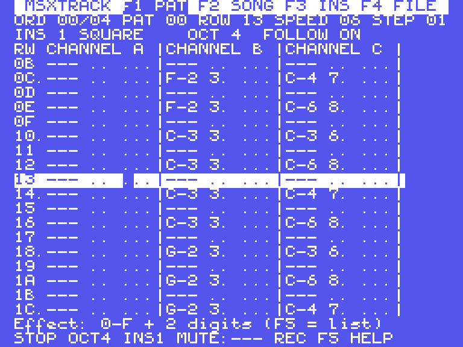
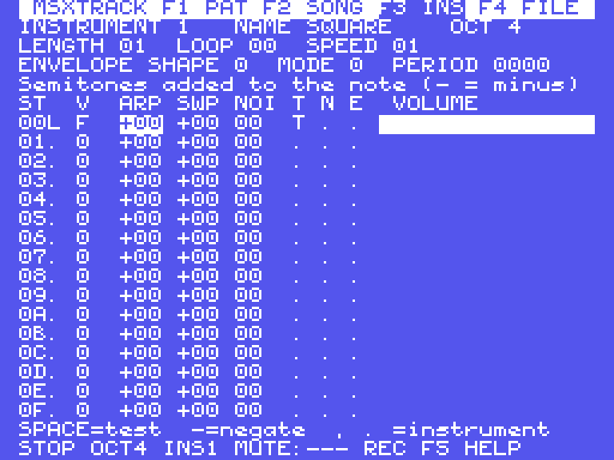
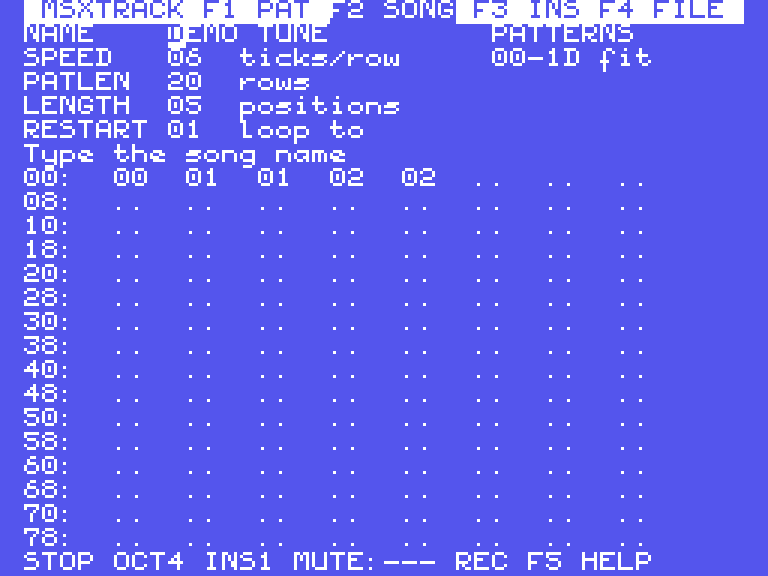

# MSXTRACK – an all-in-one chiptune and sound effect maker for MSX

MSXTRACK is a music tracker that runs **on the MSX itself**. It is a 16KB ROM
cartridge written in Z80 assembly that turns any MSX into a complete
composing station for the AY-3-8910 / YM2149 PSG: pattern editor, song
arranger, instrument / sound-effect designer, and disk and tape storage.



## Runs on every MSX

* **Any MSX1, MSX2, MSX2+ or turbo R** with at least 16KB of RAM (that's every
  model except a couple of 8KB machines like the Casio PV-7 without its
  expansion; on those it says so instead of crashing).
* Uses only BIOS calls for the screen and keyboard and the standard PSG ports,
  so it works with any VDP, any keyboard layout (international, Japanese,
  European) and any slot layout, including expanded slots.
* Works with the original BIOS and with the free **C-BIOS**.
* All PSG writes happen inside the interrupt, so they never clash with the
  BIOS. Register 7 always keeps the MSX-required I/O bits (port A input,
  port B output).
* It starts after every other ROM, so disk drives are set up. When a disk
  drive is present it saves and loads through Disk BASIC, and it chains the
  disk ROM's interrupt hook so the drive motor still switches off.
* RAM is detected at start: 64KB machines hold 31 patterns, 16KB machines
  about 10.

Tested in openMSX on MSX1 (international and Japanese), MSX2, MSX2+ and a
16KB MSX1 (see `test/`).

## Running it

Use `build/msxtrack.rom` like any 16KB cartridge ROM:

* **Emulator:** `openmsx -carta build/msxtrack.rom` (or the cartridge slot in
  blueMSX, fMSX, WebMSX…).
* **Real MSX:** write it to a flash cartridge (MegaFlashROM, Carnivore,
  etc.) as a plain 16KB ROM, or load it with a ROM loader such as ODO/SofaRun.

It starts in the pattern editor with a demo song loaded. Press **RETURN** to
hear it.

## Screens

| Key | Screen |
|-----|--------|
| F1  | Pattern editor |
| F2  | Song: name, speed, rows per pattern, length, loop point, order list |
| F3  | Instrument / sound-effect editor |
| F4  | File: disk save/load/directory, tape save/load, new song, demo |
| F5  | Help (3 pages, built in) |
| ESC | Stop playback (works everywhere) |
| SHIFT+F1/F2/F3 | Mute channel A/B/C · SHIFT+F4 follow on/off · SHIFT+F5 unmute all |

### Pattern editor (F1)

Three channels, up to 64 rows per pattern. Every cell is
`NOTE INSTRUMENT VOLUME EFFECT`, for example `C-4 1F A03`.

| Keys | Action |
|------|--------|
| Arrows | Move (SHIFT+UP/DOWN: 16 rows, SHIFT+LEFT/RIGHT: previous/next song position) |
| HOME / SHIFT+HOME | First / last row |
| `Z S X D C V G B H N J M` | Piano, lower octave |
| `Q 2 W 3 E R 5 T 6 Y 7 U I 9 O 0 P` | Piano, upper octave |
| `1` | Note off (`===`) |
| `0-9 A-F` | Instrument, volume and effect columns |
| DEL / BS / INS | Clear field / delete row / insert row |
| `[` `]` | Octave down/up |
| `,` `.` | Previous/next instrument |
| `<` `>` | Pattern number used at this song position |
| `-` `=` | Edit step (how many rows the cursor moves after input, 0–16) |
| SPACE | Play/stop the current pattern (loops) |
| RETURN | Play/stop the song from this position (SHIFT+RETURN: from this row) |
| CTRL+Z | Undo the last change; press again to redo |
| CTRL+J | Jam mode on/off: piano keys play notes without writing them |
| CTRL+N | Add a new song position after this one with an empty pattern |
| CTRL+B | Add a new position with a copy of this pattern, ready for a variation |
| CTRL+C / CTRL+V | Copy/paste the track (channel) |
| CTRL+A / CTRL+P | Copy/paste the whole pattern |
| CTRL+U / CTRL+D | Transpose the track up/down a semitone |
| CTRL+E | Clear the track |

Piano keys follow the letters printed on the keys, so on an AZERTY keyboard
the layout moves with them.

Every editor has a **hint line** that explains the field under the cursor. In
the effect column it names the effect you are on, for example
`4xy VIBRATO speed x, depth y`. The status line shows whether you are in
**REC** (keys write notes) or **JAM** (keys only play) mode.

### Effects

| Effect | Meaning |
|--------|---------|
| `0xy` | Arpeggio: note, +x, +y semitones |
| `1xx` / `2xx` | Pitch slide up / down |
| `3xx` | Portamento to the new note, speed xx |
| `4xy` | Vibrato, speed x, depth y |
| `5xx` / `6xx` | Hardware envelope period high / low byte |
| `7xy` | Hardware envelope shape y (restarts the envelope) |
| `8xx` | Noise period override (`20`+ = back to the instrument's) |
| `9xx` | Delay the note by xx ticks |
| `Axy` | Volume slide up x or down y per tick |
| `Bxx` | Jump to song position xx |
| `Cxx` | Cut the note after xx ticks |
| `Dxx` | Go to the next position, starting at row xx |
| `Exx` | Detune (signed offset to the tone period) |
| `Fxx` | Speed: ticks per row |

Effects 0–4 and A keep running on the following rows until `000` or a new
note.

### Instruments and sound effects (F3)



15 instruments. Each one is a sequence of up to 16 steps that plays at
`SPEED` ticks per step and can loop from any step. Each step has:

* **V**: volume 0–F
* **ARP**: semitone offset (arpeggios, octave clicks, chords)
* **SWP**: pitch sweep added every tick (kicks, lasers, sirens, jumps)
* **NOI**: noise period 00–1F
* **T / N / E**: tone on, noise on, hardware envelope on

The hardware envelope uses `SHAPE`, plus either a fixed `PERIOD` (mode 0) or a
period that follows the note (modes 1–4; mode 2 matches the note's pitch).
That gives the classic AY "buzz bass" and sync sounds.

SPACE plays the instrument as a test sound and the live step is marked with
`>`. Use CTRL+C/CTRL+V to copy instruments and `-` to negate ARP/SWP.

A new song comes with presets you can use straight away or start from:
SQUARE, PLUCK, BASS, ARP MAJ, ARP MIN, KICK, SNARE, HIHAT, BUZZBASS, LASER,
EXPLODE, COIN, JUMP, PAD, SIREN.

**Sound effects:** design them as instruments (sweeps, noise, arpeggios and
loops give lasers, explosions, coins, jumps and alarms). Then lay them out in
a pattern with speed 1 for longer, scripted effects.

### Song (F2)



Set the name, speed, rows per pattern, song length and restart position, and
edit the 128-entry order list. In the order list, INS duplicates a position,
DEL removes one, and RETURN jumps to that position in the pattern editor.

### Files (F4)

* **Disk:** S save, L load, D list the `.MTK` songs on the disk. Disk errors
  (no disk, write protected…) are caught and reported, not crashed on.
* **Tape:** W write, R read, through the BIOS cassette routines with a
  checksum.
* **N** new song, **X** reload the demo.
* Your work is protected. Starting a new song or loading one warns you if
  the current song has unsaved changes, and saving over an existing disk
  file asks first.

## Song file format (`.MTK`)

The format is simple so you can use songs in your own programs:

| Size | Content |
|------|---------|
| 6 | `"MSXTRK"` |
| 1 | version (1) |
| 1 | number of patterns N |
| 32 | settings: speed, rows per pattern, length, restart, name[16], reserved |
| 128 | order list (pattern numbers) |
| 1536 | 16 instruments × 96 bytes (slot 0 unused) |
| N × 768 | patterns: 64 rows × 3 channels × 4 bytes |

Pattern cell: `note` (0 empty, 1–96 = C-1…B-8, 97 off), `instrument<<4 | volume`,
`flags` (bit7 volume present, bit6 effect present, bits 0–3 effect),
`effect parameter`.

Instrument: `length, loop (FF none), speed, envelope shape, envelope mode,
period lo, period hi, reserved, name[8]`, then 16 steps of
`volume, arp, sweep, noise, flags (1 tone, 2 noise, 4 envelope)`.

Tape files are the same bytes followed by a one-byte checksum.

## Using songs in games: the MTKPLAY replayer

`replayer/mtkplay.asm` is a standalone replayer you can include in your own
MSX program to play `.MTK` songs and fire sound effects. It is generated from
the tracker's own engine, so songs sound exactly as they do in the editor:
the test suite checks that the replayer and the tracker write identical PSG
registers frame by frame.

* About 2.3KB of code and tables, plus 175 bytes of RAM wherever you like.
* Songs can stay in ROM; the replayer only reads them.
* One sound-effect voice on top of the music. Any instrument can be a sound
  effect. It takes over one channel and hands it back to the music when it
  ends.
* Every label starts with `mtk_`, so it won't clash with your own names.

```z80
MTK_RAM equ 0E000h              ; 175 bytes of RAM for the replayer
        include "mtkplay.asm"

        ld hl,song              ; a .MTK file saved by MSXTRACK
        call mtk_init           ; Z = valid song
        xor a
        call mtk_start          ; play from position 0 (loops)
        ; ...and from your H.TIMI interrupt hook, once per frame:
        call mtk_frame

        ld a,10                 ; instrument 10 (LASER)
        ld b,61                 ; note C-6 (1 = C-1, 49 = C-5)
        ld c,2                  ; on channel C
        call mtk_sfx

song:   incbin "mysong.mtk"
```

| Call | Input | Does |
|------|-------|------|
| `mtk_init` | HL = .MTK file | Checks and prepares the song (Z = ok). Music stopped. |
| `mtk_start` | A = position | Plays the song from that position; loops at the end |
| `mtk_stop` | – | Stops the music (sound effects continue) |
| `mtk_frame` | – | Call once per frame from the interrupt: plays and writes the PSG |
| `mtk_sfx` | A = instrument, B = note, C = channel | Plays a sound effect over the music on that channel |
| `mtk_sfx_stop` | – | Ends the sound effect |
| `mtk_sfx_bank` | HL = .MTK file | Takes sound-effect instruments from another file (e.g. an "SFX only" song) |

A non-looping instrument ends after its last step. A looping one (e.g.
SIREN) plays until `mtk_sfx_stop`. You can read `mtk_PL_PLAYING`,
`mtk_PL_ORDPOS`, `mtk_PL_ROW` and `mtk_SFX_ON` to sync game events to the
music. Full notes are in the header of `mtkplay.asm`.

**Example:** `replayer/example/example.asm` builds `build/example.rom`. It's a
cartridge that plays the demo song: SPACE turns the music on and off, keys
1–7 fire sound effects (kick, snare, laser, explosion, coin, jump, siren) and
0 stops a looping effect.

**Workflow for a game:** compose the music in MSXTRACK and save it to disk
as `.MTK`. Put your sound effects in instruments, in the same song or in a
separate song used as an SFX bank. Then `incbin` the file(s) into your
program.

## Timing note

Playback advances one tick per video interrupt, so a song runs at 60 ticks/s
on Japanese/American (60Hz) machines and 50 ticks/s on European (50Hz) ones.
This is the same as nearly all MSX games.

## Building

Needs `pasmo` and `python3`:

```sh
./build.sh          # -> build/msxtrack.rom, replayer/mtkplay.asm, build/example.rom
test/run_tests.sh   # optional: automated tests in openMSX + C-BIOS
```

| File | Contents |
|------|----------|
| `src/main.asm` | Cartridge header, start-up, RAM detection, main loop, keyboard |
| `src/player_core.asm` | Replay engine, shared by the tracker and the game replayer |
| `src/player.asm` | Tracker side of the engine (interrupt hook, preview) |
| `src/edpat.asm` / `edsong.asm` / `edins.asm` | The three editors |
| `src/file.asm` | Disk (BDOS) and tape storage |
| `src/ui.asm`, `help.asm` | Text screen helpers and built-in help |
| `src/song.asm` | New song, preset instruments, demo song |
| `tools/gen_tables.py` | Note frequency, volume and vibrato tables |
| `tools/gen_song.py` | Preset instruments and demo song data |
| `tools/gen_replayer.py` | Builds `replayer/mtkplay.asm` from the engine core (+ `tools/replayer_*.asm`) |
| `replayer/` | Standalone game replayer and example cartridge (`example/demo.mtk` is the demo song) |
| `test/` | openMSX tests for the tracker and the replayer, including an emulated disk BDOS |
